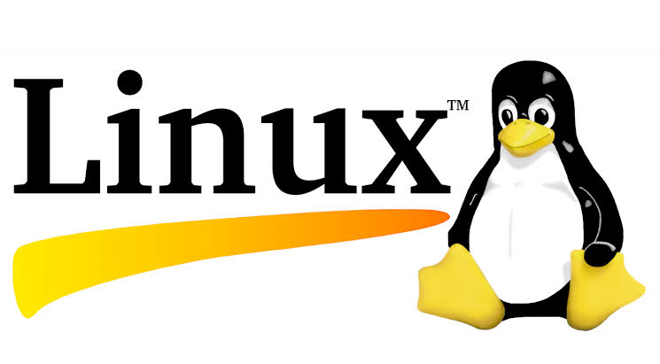
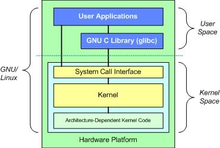
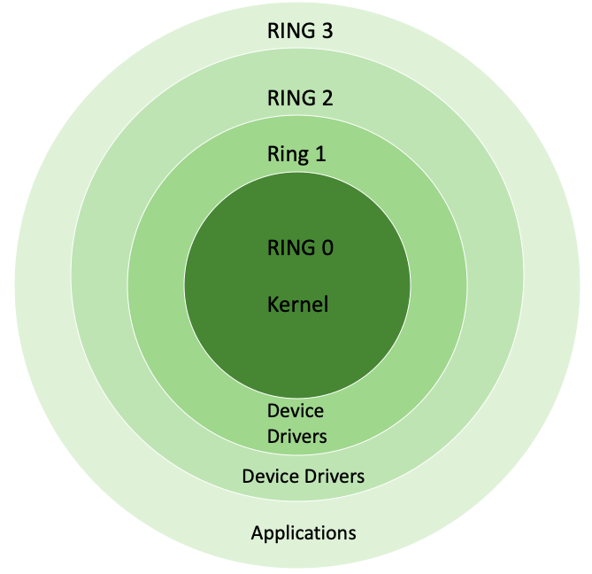
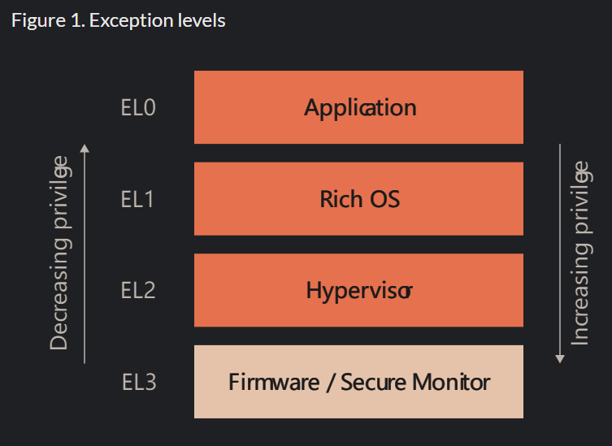
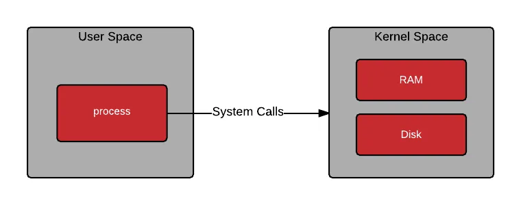
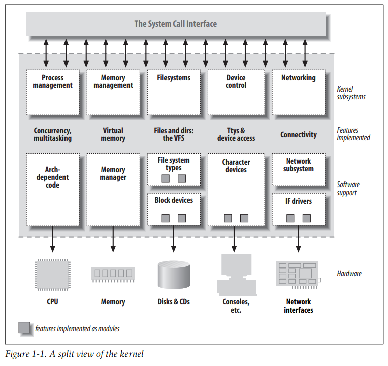

# Section 8

- **Section**: Linux Kernel Programming
- **Topic**: Linux OS Overview & Kernel Module/Driver Basics 
- **Purpose**: Understand the user-space/kernel-space split, get a conceptual map of the Linux kernel's major components, and write a minimal Loadable Kernel Module and driver.
- **Expectation**: Kernel component-map diagram + working hello.ko module + minimal GPIO driver controlling an LED/button on the target board.

---

## 1. Operating System Basics

### 1.1. What an OS is

An operating system (OS) is a collection of software that manages a computer’s hardware and applications by allocating resources, including memory, CPU, input/output devices and file storage.

A user interacts with an operating system through a user interface (UI), which can be either a graphical user interface (GUI) or a command-line interface (CLI).

### 1.2. What an OS does

- **Process management:** schedules and synchronizes processes and threads, and handles inter-process communication through system calls.

- **Memory management**: allocates RAM so programs don’t interfere with each other, and uses paging and swapping to move data between RAM and disk.

- **File system management**: organizes files and directories, handles naming and permissions, and protects data integrity with checksums and error-correcting codes.

- **Device management**: gives software a standard interface to I/O devices (keyboards, disks, printers, monitors), including virtual devices in virtualized setups.

- **Security and access control**: enforces authentication, encryption, and permissions so only authorized users get access.

- **Networking**: supports communication over LANs and the internet using protocols like TCP/IP.

- **Error detection and handling**: monitors for hardware and software faults, then reports and helps recover from them.

- **Resource allocation**: divides CPU time, memory, and I/O devices to keep performance high.

- **Performance monitoring**: tracks memory usage, running processes, and logs, and adjusts resources to improve efficiency.

## 2. Linux Operating System

### 2.1. What Linux is

Linux is a free, open-source operating system (OS) based on Unix, created by Linus Torvalds in 1991.

### 2.2. Main components

- **Kernel**: The core of Linux, it manages hardware and provides services to everything above it.

- **System Call Interface**: The boundary between user space and kernel space (e.g. `open`, `read`, `write`, `fork`, `mmap`, `ioctl`)

- **C Standard Library** (`glibc`): Provide standard APIs and wrap system calls

- **Shell**: Command interpreter that launches programs and runs scripts

- **Applications**: User programs and daemons

## 3. User Space vs. Kernel Space

The CPU has privilege levels:
- x86 uses Protection rings: Ring 0, 1, 2, 3
    
- ARM use Expection levels: EL0, EL1, EL2, EL3
    

Linux uses two:
- Supervisor (kernel) mode: ring 0 on x86, EL1 on ARM
- User mode: ring 3 on x86 / EL0 on ARM

User space: "the space controlled by a user"

- is where applications run, in user mode.
- Code there can't touch hardware, page tables or other processes's memory directly.
- User programs get access to data by making special requests to the kernel called ***system calls***.

Kernel space: 

- is where the kernel runs, in kernel mode.
- The kernel provides abstraction for security, hardware, and internal data structures.

## 4. Linux Kernel Components 

### 4.1. Process Management

Creates tasks, schedules CPU time, handles signals, IPC, and process lifecycle.

### 4.2. Memory Management

Allocates physical pages, maps virtual memory, handles paging/swap, and supplies kernel allocators.

### 4.3. Filesystems/VFS

Presents one uniform file API over ext4, XFS, Btrfs, procfs, sysfs, network filesystems, etc.

### 4.4. Device Driver

Translate generic kernel requests into commands for particular hardware.

### 4.5. Network

Implements sockets, routing, IP, TCP/UDP, packet filtering, and traffic control.

## 5. Linux Kernel Module

### 5.1. What modules are

Kernel modules are pieces of code that can be loaded into and unloaded from the Linux kernel at runtime, without rebooting or recompiling the kernel.

### 5.2. Why modules exist

- Allows systems to have only a **minimal base kernel image**, with optional features and drivers supplied via loadable modules.

- Enable the removal and reloading of kernel code.

- Facilitate **debugging**.

- Allow for the **loading of new drivers** on demand in response to the hot plugging of new devices.

### 5.3. Built-in vs. Loadable Modules

||Built-in|Loadable Modules|
|-|-|-|
|**Integration**|Main kernel image (vmlinux/vmlinuz)|Separate `.ko` file under `/lib/modules/...`|
|**Loading**|Available automatically at boot|Loaded on demand with `modprobe`/`insmod`|
|**Unloading**|Cannot be unloaded without rebooting into another kernel|Unloaded with `modprobe -r` or `rmmod`|

## 6. Linux Drivers

### 6.1. What device drivers are

A device driver is a software that lets the OS or an application talk to a specific piece of software

Device drivers are distinct "black boxes" that make a particular piece of hardware respond to a well-defined internal programming interface 

They hide completely the details of how the device works.

### 6.2. Classes of Devices and Modules

The Linux way of looking at devices distinguishes between three fundamental device types:

- Character devices
- Block devices
- Network interfaces

Each module implements one of these types, is classifiable classifiable as a char module, a block module, or a network module

Character devices
- can be accessed as a stream of bytes 
- A driver usually implements at least `open`, `close`, `read`, and `write` syscalls

## 7. Module lifecycle

Build -> Load -> Init -> Live -> Unload -> Free

`module_init(x)`: module initialization entry point

- `x`: init function, must has the form `int my_init(void);`

`module_exit(x)` module exit entry point

- `x`: exit function, must has the form `void my_init(void);`

Module lifecycle: init/exit functions, insmod/rmmod/modprobe, module parameters, dependencies

`dmesg`: print or control the kernel ring buffer

## 8. Lab

### Lab 1

Draw a one-page diagram of the Linux kernel's major components (Memory Management/File System/Process Management/Network/Device Driver) and how they interact 

### Lab 2

Write hello.ko with init/exit functions and a module parameter (module_param); load/unload it and inspect dmesg 

### Lab 3

Write a minimal GPIO character driver that turns an LED on/off or reads a button state on your target board, and exercise it with simple read/write calls from userspace 