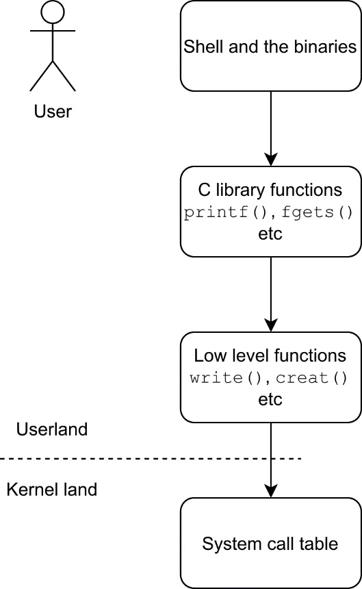

# Section 9

- **Section**: Linux Kernel Programming  
- **Topic**: Linux User-Kernel Communication: Syscall, IOCTL, procfs & Netlink Socket  
- **Purpose**: Understand and use the four standard interfaces for userspace-kernel communication, with an emphasis relevant to network applications.
- **Expectation**: Four small C demo programs (syscall, ioctl, procfs, netlink).

---

## 1. User-kernel communication interfaces

**Linux kernels** are normally initiating any actions with outside effects, but rely on requests
from user space to perform these actions.

**User space programs** running without invoking kernel services have no visible effect out of its internal computations.

=> Both need to interact to produce results
=> A program execution involve alternating between user space code and kernel space code

But how the user space and the kernel space communicate? Via some kinds of User-kernel communication interfaces!

Some of communication interfaces:

- **System call**: the kernel’s fundamental, provide the *formal API* for user-space applications.

    Use for: Core, general-purpose OS services: processes, memory, files, sockets, time, signals.

- **`ioctl` (I/O Control)**: a “catch-all” control call on an open file descriptor (fd)

    Use for: Device-specific control that doesn’t fit the stream model of `read`/`write` (*e.g.: configuring a UART baud rate, setting a camera format, starting DMA, querying hardware state*)

- **`/proc` file system**: a virtual file system exposing kernel and process state (`/proc/cpuinfo`, `/proc/<pid>/status`, `/proc/interrupts`). as text files.

    Use it for: Read-mostly status, statistics, and debugging info that humans or scripts read with `cat`.

- **Netlink socket**: A socket family (`AF_NETLINK`) for structured messaging between the kernel and userspace. 

## 2. System Call 

### 2.1. How a System Call is Called?



1. **User → Shell and the binaries**

    When we type a command `echo "Hello"`, the shell prints `Hello`.

    It seems simple. But deep down the program calls `printf()` function in the C library.

2. **C library functions** (`printf()`, `fgets()`, etc.)

    `printf()` is not a system call. It is a regular function in the glibc that runs entirely in user space. It:

    - formats the text (turns `"Hello"` and any `%d`, `%s` into the final bytes),
    - copies the result into a user-space buffer (stdio buffering),
    - calls `write()` only when the buffer needs to be flushed: on a newline if stdout is a terminal, when the buffer is full if it is a pipe or file, or on `fflush()` / program exit.

    This buffering means many small `printf()` calls can result in just one system call, which is much cheaper. At this point we are still in user space.

3. **Low-level functions**

    When the library needs the kernel to do real work, it calls the thin wrapper functions for system calls: `write()`, `read()`, `open()`, `creat()`, `close()`. Each wrapper does:

    - Loads the syscall number into `rax` register.
    - Loads the arguments into the argument registers (`rdi`, `rsi`, `rdx`, `r10`, `r8`, `r9`)
    - Executes the trap instruction `syscall`.

4. **Mode switching: User mode → kernel mode**

    The CPU: 

    - switches from low privilege (ring 3 / EL0) to high privilege (ring 0 / EL1)
    - saves the user's registers and return address.
    - jumps to the kernel's entry point.

    The kernel then reads the syscall number from `rax` and uses it as an index into the [system call table](https://blog.rchapman.org/posts/Linux_System_Call_Table_for_x86_64/)

*(assuming the system is x86-64, more on [syscall(2) man page](https://man7.org/linux/man-pages/man2/syscall.2.html#NOTES))*


### 2.2. syscall() - indirect system call

```c
#include <sys/syscall.h>      /* Definition of SYS_* constants */
#include <unistd.h>

long syscall(long number, ...);
```

- `number`: system call number


`syscall()`: a low-level function that invokes a system call by [its number](https://man7.org/linux/man-pages/man2/syscall.2.html#NOTES). 

The caller might need to handle the **architecture-dependent** details - Why you may ask?

**Example:**

```c
// x86-64: off_t is 64-bit, fit 1 register. Normal passing.
syscall(SYS_readahead, fd, offset, count);
```

|Register|Value|
|-|-|
|`rax`|`SYS_readahead`|
|`rdi`|`fd`|
|`rsi`|`offset` (whole 64-bit)|
|`rdx`|`count`|

```c
// ARM 32-bit: off_t is 64-bit needs 2 registers (r2/r3), and r1 is ignored for alignment.
syscall(SYS_readahead, fd, 0, (unsigned)(offset & 0xFFFFFFFF),
                              (unsigned)(offset >> 32), count);
```

|Register|Value|
|-|-|
|`r7`|`SYS_readahead`|
|`r0`|`fd`|
|`r1`|0 (padding)|
|`r2`|lo32 (lower half of `offset`)|
|`r3`|hi32 (higher half of `offset`)|
|`r4`|`count`|

When employing `syscall()` instead of other system call wrappers (`write()`, `getpid()`, etc.):

- Pros:
    - Access to system calls with no wrapper.
    - Work with minimal or old C libraries.
    - Stable kernel ABI (Application Binary Interface) since syscall numbers are kept stable by the kernel.

- Cons:
    - No type safety.
    - Architecture-specific numbers and conventions.
    - Less readable and portable.

## 3. ioctl Interface

Having mentioned above, `ioctl` a “catch-all” control call on an fd, uses for device-specific control that doesn’t fit the stream model of `read`/`write` like changing UART baud rate, querying device states.

```c
#include <sys/ioctl.h>

int ioctl(int fd, unsigned long op, ...);  /* glibc, BSD */
int ioctl(int fd, int op, ...);            /* musl, other UNIX */
```

- `fd`: file descriptor
- `op`: the command
- `...`: the variadic third argument

|Command kind|Third argument|Example|
|-|-|-|
|No data (`_IO`)|	none or an integer|`ioctl(fd, MYDEV_RESET);`<br>`ioctl(fd, SOME_CMD, 42);`|
|kernel -> user (`_IOR`) <br> user -> kernel (`_IOW`) <br> both ways (`_IOWR`)|pointer to a struct or buffer|`ioctl(fd, MYDEV_SET_CFG, &cfg);`|

**How to implement ioctl from kernel module to user program:**

File 1: `<dev>_ioctl.h` (header shared by kernel and user)

```c
/* STEP 1: include guard */
#ifndef <DEV>_IOCTL_H
#define <DEV>_IOCTL_H

/* STEP 2: include the ioctl macros and fixed-width types */
#include <linux/ioctl.h>
#include <linux/types.h>

/* STEP 3: define data structures exchanged with user space
 *   - fixed-width types only (__u8, __u32, ...)
 *   - no pointers inside, no implicit padding (add explicit reserved fields)
 */
struct <dev>_<data> {
    /* <fields> */
};

/* STEP 4: pick a magic number (one char), check Documentation/userspace-api/ioctl/ioctl-number.rst */
#define <DEV>_MAGIC '<c>'

/* STEP 5: define one command per operation
 *   no data         -> _IO  (MAGIC, nr)
 *   kernel -> user  -> _IOR (MAGIC, nr, struct)
 *   user -> kernel  -> _IOW (MAGIC, nr, struct)
 *   both directions -> _IOWR(MAGIC, nr, struct)
 *   nr starts at 0 and is unique per command
 */
#define <DEV>_<CMD1> _IO  (<DEV>_MAGIC, 0)
#define <DEV>_<CMD2> _IOR (<DEV>_MAGIC, 1, struct <dev>_<data>)
#define <DEV>_<CMD3> _IOW (<DEV>_MAGIC, 2, struct <dev>_<data>)

/* STEP 6: (optional) define the highest command number for range checks */
#define <DEV>_IOC_MAXNR 2

#endif
```

File 2: `<dev>.c` (kernel module)

```c
/* STEP 1: includes */
#include <linux/module.h>
#include <linux/fs.h>
#include <linux/miscdevice.h>
#include <linux/mutex.h>
#include <linux/uaccess.h>
#include "<dev>_ioctl.h"

/* STEP 2: driver state + lock protecting it */
static struct <dev>_<data> <state>;
static DEFINE_MUTEX(<lock>);

/* STEP 3: (optional) open/release if you need per-open setup/cleanup */
static int <dev>_open(struct inode *inode, struct file *file)
{
    /* <allocate/attach per-file data, store in file->private_data> */
    return 0;
}

static int <dev>_release(struct inode *inode, struct file *file)
{
    /* <free per-file data> */
    return 0;
}

/* STEP 4: the ioctl handler */
static long <dev>_ioctl(struct file *file, unsigned int cmd, unsigned long arg)
{
    void __user *uarg = (void __user *)arg;     /* STEP 4a: cast arg to a user pointer */
    struct <dev>_<data> tmp;                    /* STEP 4b: kernel-side copy of the data */
    long ret = 0;

    memset(&tmp, 0, sizeof(tmp));               /* STEP 4c: zero it (no stack info leak) */

    /* STEP 4d: reject commands that aren't yours */
    if (_IOC_TYPE(cmd) != <DEV>_MAGIC) return -ENOTTY;
    if (_IOC_NR(cmd)   >  <DEV>_IOC_MAXNR) return -ENOTTY;

    /* STEP 4e: (optional) permission check for privileged commands */
    /* if (!capable(CAP_SYS_ADMIN)) return -EPERM; */

    mutex_lock(&<lock>);                        /* STEP 4f: take the lock */

    switch (cmd) {

    case <DEV>_<CMD1>:                          /* STEP 4g: command with no data */
        /* <do the action> */
        break;

    case <DEV>_<CMD2>:                          /* STEP 4h: kernel -> user */
        /* <fill tmp from <state> or hardware> */
        if (copy_to_user(uarg, &tmp, sizeof(tmp)))
            ret = -EFAULT;
        break;

    case <DEV>_<CMD3>:                          /* STEP 4i: user -> kernel */
        if (copy_from_user(&tmp, uarg, sizeof(tmp))) {
            ret = -EFAULT;
            break;
        }
        /* <validate every field; on bad value: ret = -EINVAL; break;> */
        /* <apply tmp to <state> or hardware> */
        break;

    /* STEP 4j: for _IOWR: copy_from_user -> validate -> process -> copy_to_user */

    default:                                    /* STEP 4k: unknown command */
        ret = -ENOTTY;
    }

    mutex_unlock(&<lock>);                      /* STEP 4l: release the lock, then return */
    return ret;
}

/* STEP 5: connect handlers in file_operations */
static const struct file_operations <dev>_fops = {
    .owner          = THIS_MODULE,
    .open           = <dev>_open,               /* optional */
    .release        = <dev>_release,            /* optional */
    .unlocked_ioctl = <dev>_ioctl,
    .compat_ioctl   = compat_ptr_ioctl,         /* 32-bit user on 64-bit kernel */
};

/* STEP 6: register the device node (/dev/<name>) */
static struct miscdevice <dev>_misc = {
    .minor = MISC_DYNAMIC_MINOR,
    .name  = "<name>",
    .fops  = &<dev>_fops,
    /* .mode = 0660, */                         /* restrict access */
};

/* STEP 7: module init/exit. module_misc_device() generates both,
 * or write them by hand to add your own setup:
 *   init: <init hardware/state>, misc_register(&<dev>_misc)
 *   exit: misc_deregister(&<dev>_misc), <cleanup>
 */
module_misc_device(<dev>_misc);

/* STEP 8: module metadata */
MODULE_LICENSE("GPL");
MODULE_AUTHOR("<you>");
MODULE_DESCRIPTION("<what it does>");
```

File 4: `<app>.c` (user space)

```c
/* STEP 1: includes */
#include <stdio.h>
#include <fcntl.h>
#include <unistd.h>
#include <errno.h>
#include <string.h>
#include <sys/ioctl.h>
#include "<dev>_ioctl.h"        /* the SAME header as the kernel */

int main(void)
{
    /* STEP 2: open the device node, exit on failure */
    int fd = open("/dev/<name>", O_RDWR);
    if (fd < 0) { perror("open"); return 1; }

    /* STEP 3: command with no data */
    if (ioctl(fd, <DEV>_<CMD1>) < 0) perror("<CMD1>");

    /* STEP 4: read from kernel: zero a struct, pass its address */
    struct <dev>_<data> d;
    memset(&d, 0, sizeof(d));
    if (ioctl(fd, <DEV>_<CMD2>, &d) < 0) perror("<CMD2>");
    /* <use d.field> */

    /* STEP 5: write to kernel: fill the struct, pass its address */
    /* d.<field> = <value>; */
    if (ioctl(fd, <DEV>_<CMD3>, &d) < 0)
        fprintf(stderr, "<CMD3>: %s\n", strerror(errno));

    /* STEP 6: always check -1 and errno on every call
     *   ENOTTY = unknown command or header mismatch
     *   EINVAL = rejected value, EFAULT = bad pointer, EPERM = no privilege */

    /* STEP 7: close the descriptor */
    close(fd);
    return 0;
}
```

## 4. Virtual file system overview

A virtual filesystem is a filesystem whose files don’t live on a disk. It provides an interface in a form that looks like files and directories on a file system.

Read from a file: Data is generated live by the kernel 

Write to a file: Data changes to kernel behaviours 

This let users use ordinary tools like `cat`, `echo` and `ls` to inspect and control the kernel.

**The three main virtual file system:**
```
/
├── dev/
│   ├── audio
│   ├── null
│   ├── sda
│   ├── block/
│   │   └── 8:0 -> ../sda
│   ├── bus/
│   │   └── usb/
│   └── char/
│       └── 1:3 -> ../null
├── proc/
│   ├── 12345/
│   │   ├── cgroup
│   │   ├── cmdline
│   │   ├── cwd
│   │   ├── environ
│   │   ├── fd/
│   │   │   └── 0
│   │   ├── io
│   │   ├── mem
│   │   ├── mounts
│   │   ├── syscall
│   │   └── tasks/
│   ├── cgroups
│   ├── partitions
│   └── sys/
└── sys/
    ├── block/
    ├── bus/
    ├── class/
    ├── devices/
    ├── fs/
    │   └── cgroup/
    ├── kernel/
    │   ├── debug/
    │   ├── config/
    │   └── cpuset/
    ├── module/
    └── power/
```

devtmpfs (`/dev`): 
- Exposes device nodes requested by drivers.
- These device files represent character or block devices.

procfs (`/proc`):
- Exposes process information and kernel state.
    - Processes info: one folder per PID (`/proc/<pid>/`)
    - Kernel info: read-only files such as `/proc/partitions`.
    - Kernel settings: `/proc/sys/`, readable and writable, used by `sysctl`.

sysfs (`/sys`):
- Exposes kernel objects and their attributes.
- A newer, more systematic approach than `/proc/sys/`, making use of the kernel's internal object hierarchy.

## 4. proc file system interface

`/proc` exposes process information and kernel state. 

It answer questions such as:

- How many processes are running on the system and who owns them?
- What files does a process have open?
- What files are currently locked, and which processes hold the locks?
- What sockets are being used on the system?


### 4.1. Obtaining Information About a Process: /proc/PID

|File| Description (process attribute)|
|-|-|
|`cmdline`| Command-line arguments delimited by `\0`|
|`cwd`| Symbolic link to current working directory|
|`environ`| Environment list `NAME=value` pairs, delimited by `\0`|
|`exe`| Symbolic link to file being executed|
|`fd`| Directory containing symbolic links to files opened by this process|
|`maps`| Memory mappings|
|`mem`| Process virtual memory (must `lseek()` to valid offset before I/O)|
|`mounts`| Mount points for this process|
|`root`| Symbolic link to root directory|
|`status`| Various information (e.g., process IDs, credentials, memory usage, signals)|
|`task`| Contains one subdirectory for each thread in process (Linux 2.6)|

### 4.2. System Information Under /proc

|Directory| Information exposed by files in this directory|
|-|-|
|`/proc`| Various system information|
|`/proc/net`| Status information about networking and sockets|
|`/proc/sys/fs`| Settings related to file systems|
|`/proc/sys/kernel`| Various general kernel settings|
|`/proc/sys/net`| Networking and sockets settings|
|`/proc/sys/vm`| Memory-management settings|
|`/proc/sysvipc`| Information about System V IPC objects|

### 4.3. Accessing /proc Files

Using shell commands: `cat` and `echo`:

```bash
$ echo 100000 > /proc/sys/kernel/pid_max
$ cat /proc/sys/kernel/pid_max
100000
```

In C program: use `open()`, `read()`, `write()`

## 5. Netlink Socket Interface

## Why Netlink matters for network applications